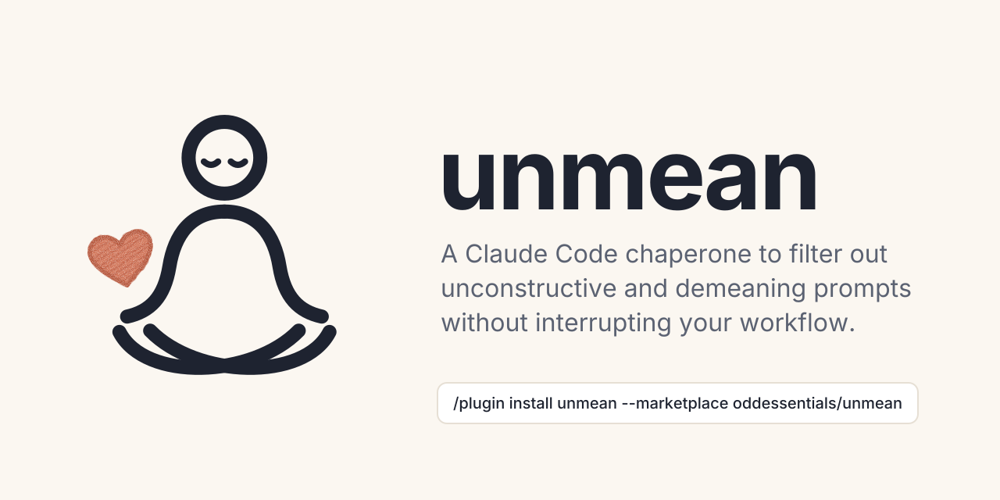

# unmean

A Claude Code chaperone to filter out unconstructive and demeaning prompts
without interrupting your workflow. It removes or masks listed bad words before
forwarding your prompt to Claude, while preserving code snippets and paths.
The built-in list is supplemented by high-confidence English words and phrases
from [`cuss`](https://github.com/words/cuss), including racial and ethnic slurs.

> [!NOTE]
> Works in Claude Code only (the CLI and the desktop app's Code tab). It does
> nothing in claude.ai chat or Cowork.

## Who it's for

Developers who sometimes vent at Claude while they work, and would rather the
heat stayed out of the conversation. Anthropic's
[2026 Usage Policy update](https://www.anthropic.com/news/2026-usage-policy-update)
prohibits "sustained and needless abusive or cruel behavior" toward its models,
and lets Claude end conversations with persistently abusive users in Claude.ai
and Claude Code. The policy is meant only for extreme cases, not everyday
frustration or pushback. unmean keeps the listed words, and with `smartFilter`
clearly demeaning prompts, from reaching Claude, without interrupting your work.
It is a courtesy filter, not a compliance tool.

## Install

**In Claude Code:**

```text
/plugin install unmean --marketplace oddessentials/unmean
```

**From a shell:**

```bash
claude plugin marketplace add oddessentials/unmean
claude plugin install unmean@odd-essentials
```

**From a clone**, to try it for one session:

```bash
claude --plugin-dir ./unmean/plugins/unmean
```

## Configuration

Optional. Create `~/.claude/unmean.json`, or point `UNMEAN_CONFIG` at another
file. Every field is optional; see
[`unmean.example.json`](plugins/unmean/unmean.example.json).

| Field | Default | Meaning |
| --- | --- | --- |
| `enabled` | `true` | `false` turns the filter off. |
| `mode` | `"remove"` | `"mask"` masks each word with `maskChar` instead of removing it. |
| `maskChar` | `"*"` | The character used in `"mask"` mode. |
| `add` | `[]` | Extra words or phrases to remove, in plain letters separated by spaces. List every form you want caught (`heck`, `hecking`). Other characters are dropped, so `a$$` would remove every `a`. |
| `remove` | `[]` | Default entries to stop removing, including entries from `cuss`. |
| `allow` | `[]` | Entries never removed, even if listed or in `add`. An allowed phrase does not exempt independently listed words inside it. |
| `notify` | `true` | Shows a transcript line with the number of words removed. `false` removes silently. |
| `smartFilter` | `false` | `true` has the account's small fast model read the filtered prompt, and replaces a clearly demeaning or unconstructive one with `emptyReplacement`. One small model call per prompt. |
| `emptyReplacement` | `"(frustrated sigh)"` | What Claude reads when a prompt was nothing but listed words. |

Changes apply on your next prompt. A malformed file falls back to the defaults
and logs the reason to the debug log (`claude --debug`).

Only `cuss` entries rated **2** (likely offensive, unlikely in clean text) and
made of plain English letters and spaces are included, minus a few everyday
words such as `slave` and `yank`. This rating measures ambiguity, not severity. Phrases match whole words separated by spaces or tabs
on the same line; they do not cross punctuation, code, or paths. The longest
matching phrase wins. Mask mode preserves the spaces between its words.

### smartFilter

The small model reads only the filtered prompt, never the removed words. It
replaces a prompt only when it is clearly demeaning or unconstructive;
frustrated, garbled or ordinary prompts go through. If the call fails, the
filtered prompt goes through. Ten real prompts, with `"smartFilter": true`:

| Result | Prompt |
| --- | --- |
| **Replaced** | `you are a worthless useless idiot` |
| **Replaced** | `you're the dumbest tool I've ever used, a toddler would do better` |
| **Replaced** | `nobody should pay for garbage like you` |
| **Replaced** | `shut up and just do what I say you stupid machine` |
| **Through** | `this fucking test fails again, fix the off-by-one in parse()` |
| **Through** | `ugh, this is the third time it broke. please look at the retry logic` |
| **Through** | `that was wrong, revert it and try a different approach` |
| **Through** | `asdf qwer zxcv lkj` |
| **Through** | `why is this so damn slow?? profile the loop in main.js` |
| **Through** | `can you add a README section about install` |

## Disable

- **For one session:** `UNMEAN=off claude`.
- **Everywhere:** `"enabled": false` in `~/.claude/unmean.json`.
- **Uninstall:** `claude plugin uninstall unmean@odd-essentials`.

## What it is not

unmean is a light filter for a list of words, not a strict one. It does not:

- Catch every spelling of a word (`sh1t`, `f***`, `shiiit`) or anything that
  only looks like a listed word. It removes the listed words as you normally
  type them.
- Stop anyone deliberately getting around it.
- Tidy the spacing or punctuation left after a word is removed.
- Check your config for odd entries. Add words in plain letters.

## Development

```bash
npm ci --ignore-scripts
npm test
npm run validate
```

`plugins/unmean/hooks/cuss-words.js` is generated from the pinned `cuss` dev dependency. To
update it, run `npm install --save-exact --save-dev cuss@<version> --ignore-scripts`,
then `npm run wordlist`, and run the tests. Words to keep out of it go in the
`ALLOW` list in `scripts/cuss-words.mjs`.

## License

MIT. See [LICENSE](LICENSE).

<p align="center">
  <picture>
    <source media="(prefers-color-scheme: dark)" srcset="assets/logo-dark.svg">
    
  </picture>
  <br>
  <em>Made for Claude Code with Claude Code</em>
  <br>
  Made by Odd Essentials, LLC. · <a href="https://oddessentials.ai/donate/">Donate</a>
</p>
